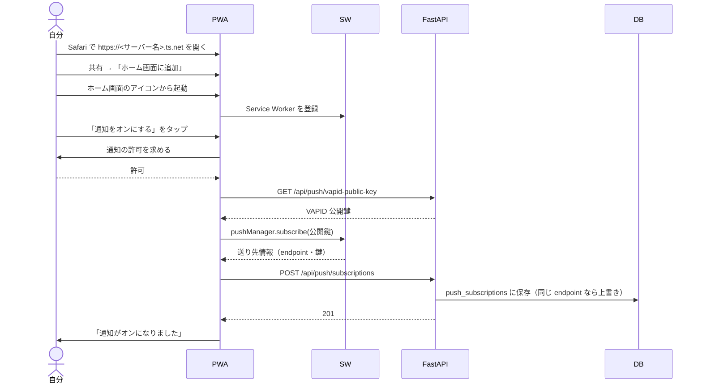
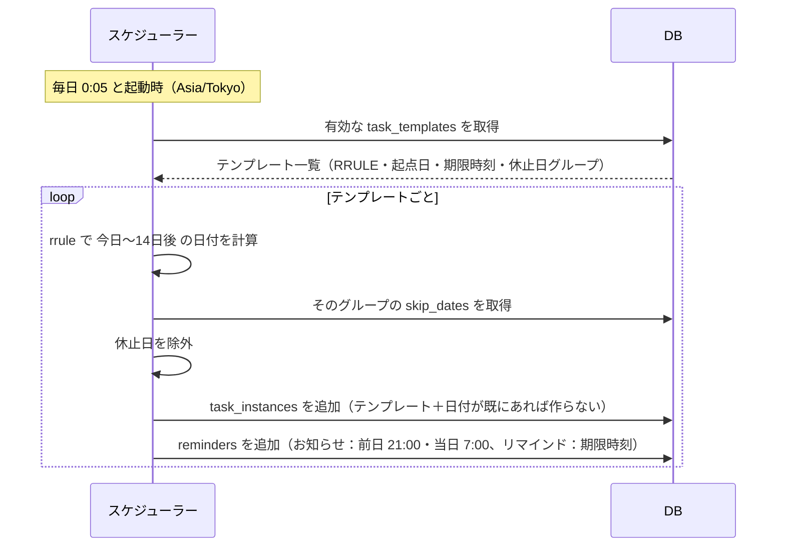
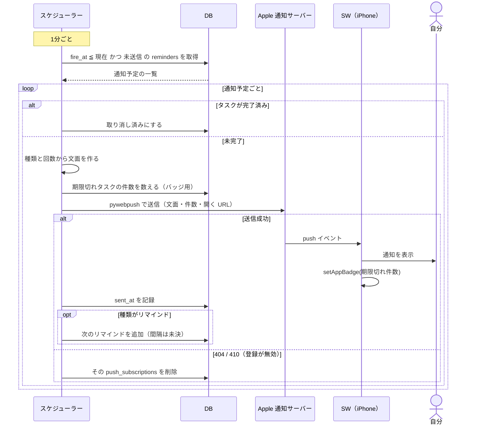
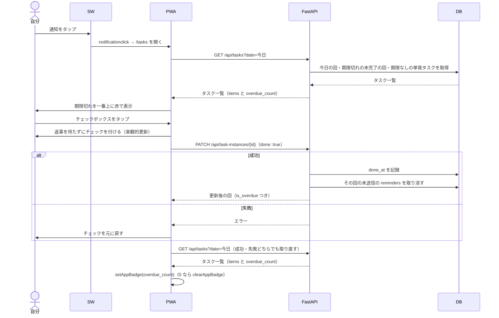
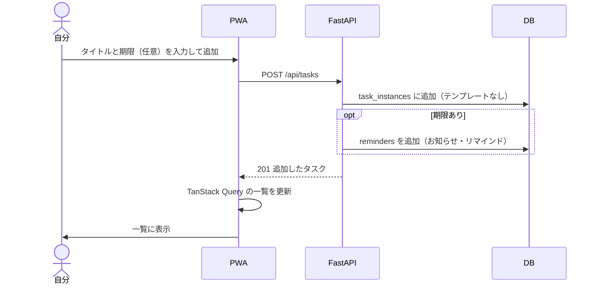
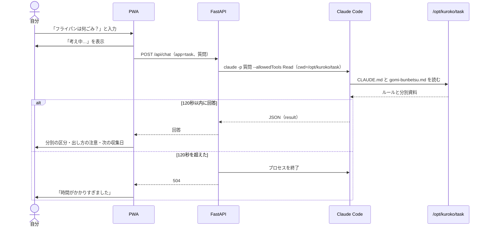
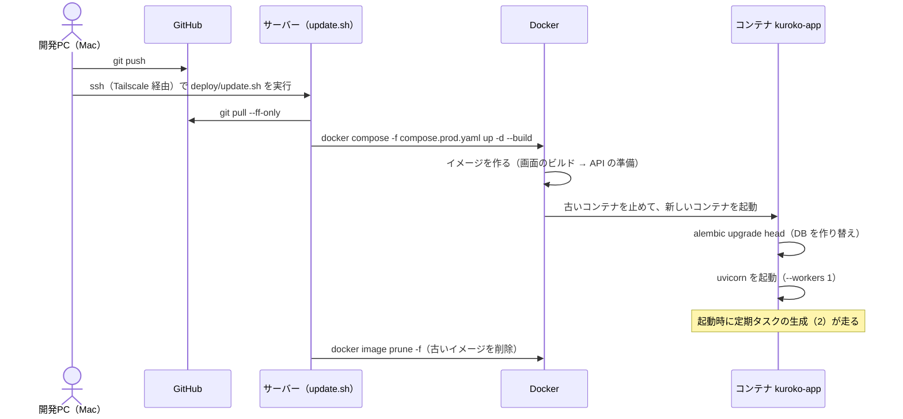
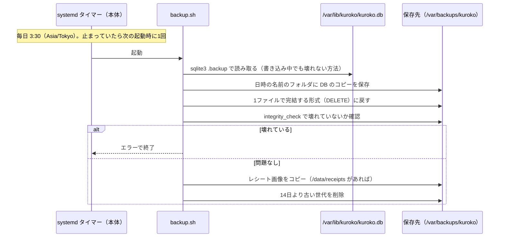
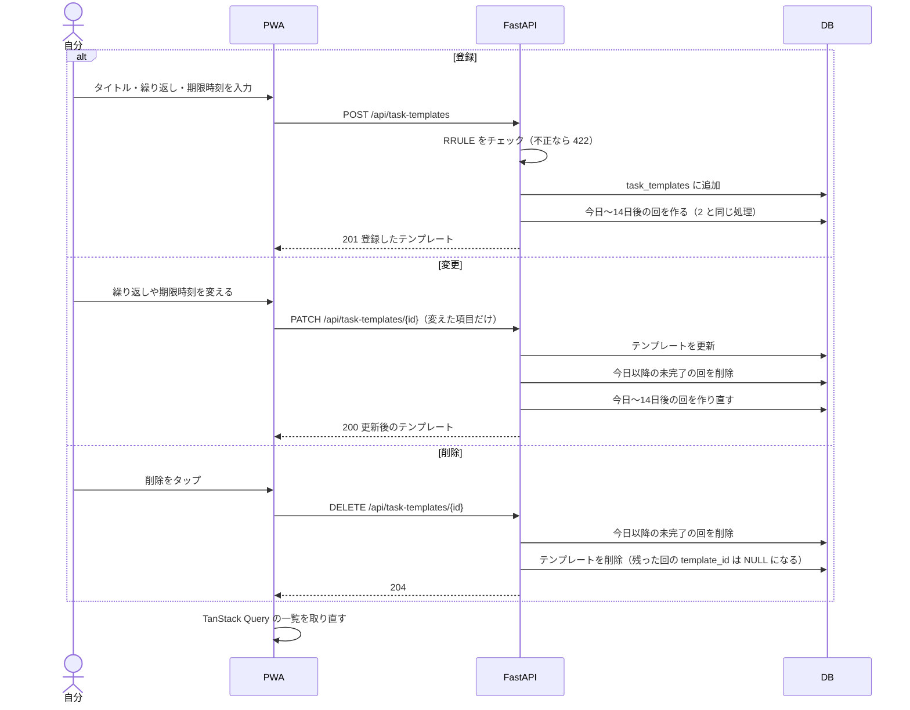
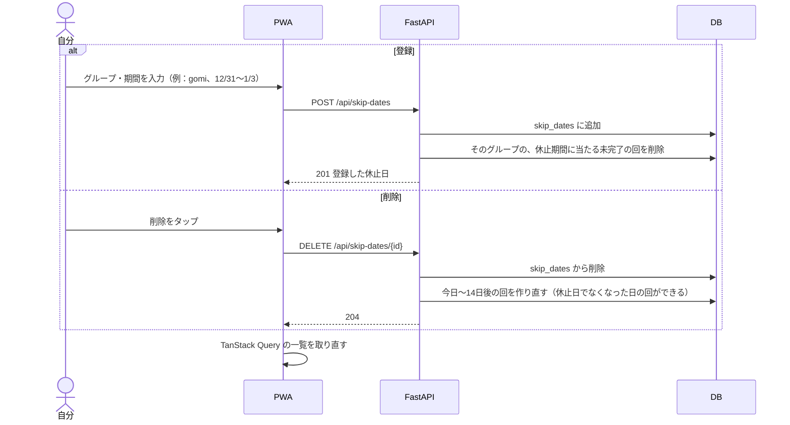

# クロコさんシステム シーケンス図

| 項目 | 内容 |
|---|---|
| ステータス | 叩き台 |
| 最終更新 | 2026-11-07 |
| 関連 | [要件定義書](要件定義書.md) |

> **凡例**：API の URL・テーブルの列名・時刻などは、すべて（案）。要件定義書の 6.1 が確定したら合わせて直す。

---

## 0. 登場するもの

| 名前 | 中身 |
|---|---|
| 自分 | 利用者（iPhone を操作する） |
| PWA | ホーム画面に追加した React の画面 |
| SW | Service Worker（通知の受信・表示、バッジの更新） |
| FastAPI | サーバーの Web API（uvicorn 1プロセス） |
| スケジューラー | FastAPI と同じプロセスで動く APScheduler |
| DB | SQLite |
| Apple 通知サーバー | Web Push の中継（Tailscale を通らない） |
| Claude Code | サーバー上の `claude -p` |

## 一覧

| No. | 処理 | フェーズ |
|---|---|---|
| 1 | 初回設定（ホーム画面への追加・通知の登録） | Phase 1 |
| 2 | 定期タスクの生成 | Phase 1 |
| 3 | 通知の送信（お知らせ・リマインド） | Phase 1 |
| 4 | 通知から開いてタスクを完了する | Phase 1 |
| 5 | 単発タスクの追加 | Phase 1 |
| 6 | ゴミ分別チャット | Phase 2 |
| 7 | サーバーへの反映 | Phase 1 |
| 8 | 毎日のバックアップ | Phase 1 |
| 9 | 定期タスク・休止日の変更 | Phase 1 |

---

## 1. 初回設定（ホーム画面への追加・通知の登録）

iPhone は、ホーム画面に追加したアプリからしか通知を受け取れず、通知の許可もボタンのタップからしか求められない（要件定義書 2.5）。

---

## 2. 定期タスクの生成

毎日深夜と、サーバーの起動時に実行する。起動時にも実行するのは、停止中に生成が抜けた分を埋めるため。

- 「テンプレート＋日付」に一意制約を付け、何度実行しても同じ回が二重にできないようにする
- 回の生成は、ここ以外にテンプレートや休止日を登録・変更したときにも走る（9 を参照）

---

## 3. 通知の送信（お知らせ・リマインド）

1分ごとに、時刻を過ぎて未送信の通知を探して送る。

- iPhone では、push を受けたら必ず通知を表示する。表示しないと、通知の許可を取り消されることがある
- サーバー停止中に時刻を過ぎたお知らせは捨て、リマインドだけ送る（案。要件定義書の未決事項に追加する）

---

## 4. 通知から開いてタスクを完了する

iPhone では通知上に「完了にする」ボタンを出せないため、通知をタップしてアプリで完了する。

- PATCH の返り値には期限切れの件数を入れない。件数は一覧を取り直して得る。件数の計算を `GET /api/tasks` の1か所にまとめるため
- 楽観的更新：外出先の遅い回線でも、タップした瞬間に反応するようにする

---

## 5. 単発タスクの追加

---

## 6. ゴミ分別チャット（Phase 2）

- 「次の収集日」を答えるには、収集曜日と休止日を Claude が知っている必要がある。MD に書くか、FastAPI が DB から次の収集日を計算して質問に添えるかを決める（未決）

---

## 7. サーバーへの反映

---

## 8. 毎日のバックアップ

バックアップは、コンテナではなくサーバー本体で実行する。DB はコンテナの外（`/var/lib/kuroko`）にあり、保存先の外付けストレージも本体側にあるため。

保存先と保存数は `/etc/default/kuroko-backup` で変えられる（なければ下の初期値を使う）。

| 設定 | 初期値 | 意味 |
|---|---|---|
| `KUROKO_DATA_DIR` | `/var/lib/kuroko` | バックアップ元（compose.prod.yaml の `/data` と同じ場所） |
| `KUROKO_BACKUP_DIR` | `/var/backups/kuroko` | 保存先。外付けストレージなど、本体とは別の場所が望ましい |
| `KUROKO_BACKUP_KEEP_DAYS` | `14` | 何日分残すか |

---

## 9. 定期タスク・休止日の変更

テンプレートや休止日を変えたら、作成済みの回もすぐに合わせる。翌日 0:05 の生成（2）を待つと、それまで古いルールの回が画面に残ってしまうため。

完了済みの回と、過去の回（期限切れを含む）は履歴として残し、消すのは**今日以降の未完了の回**だけにする。

### 9-1. 定期タスク（テンプレート）

- 定期タスクの回は、1回分だけを削除できない（409）。削除しても、次の生成で作り直されてしまうため。不要ならテンプレートを変更する

### 9-2. 休止日

- テンプレートと休止日の管理画面はまだない。今は API の説明書（`/docs`）から登録する
